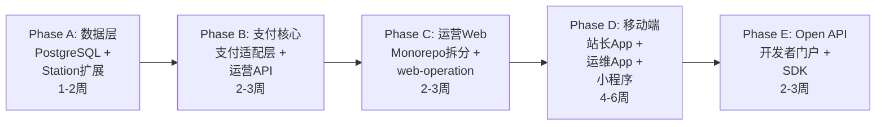

# 【研发方案】天链V3多端架构升级 — 从运维工具到能源运营平台

> 评估日期: 2026-06-21
> 版本: v1.0
> 项目上下文: [project-context](./_project-context.md)
> 方法论: requirements-analysis + Superpowers头脑风暴

## 1. 简介

### 1.1 背景

当前天链V3是面向运维团队的设备监控/告警/工单工具。丁哥提出扩展为覆盖「后端管理→运营→运维→站长→终端用户」的全链路能源平台。

### 1.2 适用范围

本文档覆盖天链V3的数据库、后端API、前端架构、移动端、小程序、Open API的全栈架构升级方案，适用于研发、测试和产品决策。

### 1.3 缩写与术语

| 术语 | 说明 |
|------|------|
| 运营 | 充电站业务经营（订单/支付/客户/营收），区别于运维（设备/告警/工单） |
| 站长 | 充电站所有者/管理者，需要自管理工具 |
| 小程序 | IM-B/支付宝小程序，面向C端充电用户 |
| OCPP | Open Charge Point Protocol，充电桩通信协议 |

### 1.4 参考文档

- [项目上下文](./_project-context.md)
- [Phase40代码审查报告](../../legion/results/phase40-review.md)
- [MEMORY.md - 模型调度策略](../../MEMORY.md)

## 2. 详细设计

### 2.1 数据层扩展

#### 2.1.1 功能说明

当前29个模型全部围绕运维场景。新需求要求支持运营数据（订单/支付/客户/账单），需要扩展Station模型 + 新增运营模型 + 数据库升级。

#### 2.1.2 方案设计

**Station 模型扩展**

```python
# 新增字段
class Station(Base):
    # --- 现有字段不变 ---
    
    # 运营开关
    operation_enabled = Column(Boolean, default=False, comment="是否启用运营功能")
    
    # 站点模式（多选）
    station_modes = Column(JSON, default=[], comment="启用的模式: [charger, pv, storage]")
    
    # 支付配置
    payment_config = Column(JSON, default={}, comment="{im-b: {mchid,apiv3}, alipay: {appid}, stripe: {sk}}")
    
    # 区域类型
    region_type = Column(String(20), default="domestic", comment="domestic/overseas")
    
    # 运营配置
    pricing_tiers = Column(JSON, default=[], comment="阶梯电价 [{start,end,price_per_kwh,service_fee}]")
    open_hours = Column(String(50), default="00:00-24:00", comment="营业时间")
    business_license = Column(String(255), comment="营业执照URL")
```

**新增运营模型（独立模块 `models/operation.py`）**

```python
# 核心运营表 (8张)
ChargingOrder    # 充电订单: user_id, station_id, gun_no, start_time, end_time, kwh, amount, status
CustomerAccount  # 用户账户: union_id(IM-B), phone, balance, points, member_level
PaymentRecord    # 支付记录: order_id, channel, amount, status, transaction_id, raw_response
StationPricing   # 电价配置: station_id, time_range, price_per_kwh, service_fee_per_kwh
Coupon           # 优惠券: code, type, value, min_amount, valid_from, valid_to
Invoice          # 电子发票: order_id, type(个人/企业), amount, tax_no, pdf_url
RechargeRecord   # 充值记录: customer_id, amount, channel, status
OperationReport  # 运营日报: station_id, date, charge_count, total_kwh, revenue, customer_growth
```

**数据库选型：必须从 SQLite 迁移到 PostgreSQL**

| 维度 | SQLite (现状) | PostgreSQL (目标) |
|------|--------------|-------------------|
| 并发写入 | 单写锁 | MVCC，高并发 |
| JSON查询 | 有限 | JSONB + GIN索引 |
| 事务隔离 | Serializable | Read Committed (默认) |
| 运营报表 | 慢，全表扫描 | 窗口函数 + 物化视图 |
| 连接池 | 不支持 | PgBouncer/内置 |

**依据**: 当前config.py已支持 `DB_TYPE=postgres` 切换，迁移成本低。

#### 2.1.3 接口设计

**新增运营API** (`backend/app/api/v1/operation/`)

| 接口 | 方法 | 路径 | 说明 |
|------|------|------|------|
| 充电订单列表 | GET | /api/v1/operation/orders | 分页+筛选(站点/时间/状态) |
| 开始充电 | POST | /api/v1/operation/orders/start | 扫码/输入枪号 |
| 结束充电 | POST | /api/v1/operation/orders/{id}/stop | 计算费用 |
| 支付下单 | POST | /api/v1/operation/payments/create | 返回支付参数 |
| 支付回调 | POST | /api/v1/operation/payments/notify/{channel} | IM-B/支付宝异步通知 |
| 用户账户 | GET | /api/v1/operation/customers/{id} | 余额/积分/订单历史 |
| 站点营收 | GET | /api/v1/operation/stations/{id}/revenue | 今日/本周/本月 |
| 电价管理 | CRUD | /api/v1/operation/pricing | 站点电价CRUD |

**修改已有接口**

| 接口 | 变更说明 |
|------|---------|
| PATCH /api/v1/stations/{id} | 新增 operation_enabled/station_modes/payment_config 可写字段 |

### 2.2 支付通道抽象

#### 2.2.1 功能说明

站点按 `region_type` 自动路由到不同支付通道。支持国内（IM-B/支付宝）和海外（信用卡/本地钱包），通过统一Provider接口扩展。

#### 2.2.2 方案设计

**Provider 模式**

```
services/payment/
├── base.py              # PaymentProvider 抽象基类
├── im-b_provider.py   # IM-B支付 (JSAPI/小程序/Native/H5)
├── alipay_provider.py   # 支付宝
├── stripe_provider.py   # Stripe (海外信用卡)
├── paypal_provider.py   # PayPal
├── router.py            # 根据 station.region_type 路由
└── webhook_handler.py   # 统一支付回调处理
```

**关键决策**

| 决策点 | 选择 | 理由 |
|--------|------|------|
| Provider抽象 | Duck typing ABC | Python惯例，比Java式interface灵活 |
| 支付回调 | Webhook统一入口 | 各通道回调格式不同，统一解析后写入PaymentRecord |
| 对账机制 | 定时任务 + 第三方账单下载 | Celery Beat 每日凌晨对账 |
| SDK依赖 | im-bpayv3 + alipay-sdk-python + stripe | 官方SDK，维护及时 |

### 2.3 多前端架构

#### 2.3.1 功能说明

当前1个前端项目承载2个入口（platform+ops）。新增运营前端后建议拆分为monorepo，支持4个Web前端 + 2个App + 1个小程序。

#### 2.3.2 方案设计

**方案对比**

| | 方案A: 保持单仓 | 方案B: Monorepo (推荐) | 方案C: 独立仓库 |
|------|---------------|---------------------|----------------|
| 代码复用 | 手动复制 | packages/shared 统一 | 每个仓各自拷贝 |
| 构建速度 | 慢（全量构建） | 快（按需构建） | 各自独立 |
| 依赖管理 | 耦合 | pnpm workspace | 各自维护 |
| 部署 | 一次全量 | 独立部署 | 独立部署 |
| 迁移成本 | 零 | 中（拆分现有前端） | 低（新开仓） |

**推荐: 方案B (pnpm workspace monorepo)**

```
tianlian-v3/
├── backend/                    # FastAPI (不变)
├── packages/
│   ├── shared/                 # 公共包
│   │   ├── types/              # TypeScript 类型定义
│   │   ├── api-client/         # 统一 API Client (axios封装)
│   │   ├── components/         # 公共 UI 组件
│   │   └── utils/              # 工具函数/auth/i18n
│   ├── web-platform/           # 平台管理端 (现有 platform 入口)
│   ├── web-ops/                # 运维管理端 (现有 ops 入口)
│   ├── web-operation/          # 运营管理端 🆕
│   └── web-landing/            # 官网/文档站 🆕
├── apps/
│   ├── app-station/            # 站长App (React Native)
│   └── app-field/              # 运维App (React Native)
├── mini-programs/
│   └── mp-user/                # 用户小程序 (Taro + React)
├── docs/
└── pnpm-workspace.yaml
```

**关键技术决策**

| 决策 | 选择 | 依据 |
|------|------|------|
| Monorepo工具 | pnpm workspace + Turborepo | Vercel生态，与Vite/React匹配 |
| 共享类型生成 | 后端 OpenAPI → TypeScript | FastAPI自带 /openapi.json |
| 移动端框架 | React Native | 与团队技术栈一致 |
| 小程序框架 | Taro (React) | IM-B+支付宝双端，React语法 |
| Web构建 | Vite (不变) | 当前已用，速度最优 |

### 2.4 运营前端（web-operation）

#### 2.4.1 功能说明

面向充电站运营方（站长的Web管理台），核心功能：充电业务管理、营收看板、客户管理、支付配置。

#### 2.4.2 方案设计

**菜单结构**

```
运营中心/
├── 运营总览     — 今日充电量/营收/活跃用户/设备利用率
├── 充电管理     — 实时充电状态/订单列表/退款处理
├── 营收分析     — 日/周/月报表/趋势图/站点对比
├── 客户管理     — 会员列表/余额/积分/充值记录
├── 电价配置     — 峰谷平电价/服务费/站点级别
├── 优惠券       — 发券/核销/统计
├── 发票管理     — 开票申请/发票记录
└── 站点设置     — 营业时间/支付通道/通知配置
```

**模式自适应机制**

```typescript
// 根据 station_modes 动态控制功能可见性
const OPERATION_FEATURES = {
  charger: ['充电管理', '充电订单', '电价配置'],
  pv:      ['发电看板', '逆变器监控', '并网电价'],
  storage: ['储能策略', '电池健康', '峰谷套利'],
};

// 混合模式取并集
function getVisibleModules(modes: string[]) {
  return [...new Set(modes.flatMap(m => OPERATION_FEATURES[m]))];
}
```

**实现**: 后端返回 `station.station_modes` → 前端 FeatureFlag 组件控制菜单和页面模块的显示/隐藏。

#### 2.4.3 接口设计

复用 2.1.3 的运营API，无需额外接口。前端通过 API Client 的 `X-Station-Id` header 区分站点。

### 2.5 移动端（站长App + 运维App）

#### 2.5.1 功能说明

- **站长App**: 移动端运营管理，核心是随时查看营收+设备告警推送
- **运维App**: 移动端现场作业，核心是扫码巡检+工单处理+拍照上传

#### 2.5.2 方案设计

**站长App 核心页面**

```
底部Tab:
├── 首页     — 今日营收卡片/充电中/告警数量/快捷入口
├── 充电     — 实时充电订单/枪状态
├── 营收     — 本周/本月趋势图
└── 我的     — 站点设置/支付配置/通知
```

**运维App 核心页面**

```
底部Tab:
├── 任务     — 待处理工单/巡检任务
├── 设备     — 扫码查设备/状态/控制
├── 告警     — 实时告警/处理/自愈
└── 我的     — 排班/技能/统计
```

**技术栈: React Native + Expo**

| 优势 | 说明 |
|------|------|
| 与Web共享代码 | packages/shared 的类型/api-client可在RN复用 |
| 热更新 | Expo OTA更新，绕过App Store审核 |
| 推送 | Expo Push Notifications |
| 扫码 | expo-camera + expo-barcode-scanner |
| 拍照 | expo-image-picker |

### 2.6 用户小程序

#### 2.6.1 功能说明

面向C端电车用户，核心流程：附近电站 → 扫码充电 → 支付 → 充电记录。

#### 2.6.2 方案设计

**框架: Taro 3 + React**

```
mini-programs/mp-user/
├── src/
│   ├── pages/
│   │   ├── index/          # 首页 (附近电站地图)
│   │   ├── station/        # 电站详情 (电价/枪状态)
│   │   ├── charge/         # 充电中 (实时电量/费用)
│   │   ├── order/          # 订单详情
│   │   ├── wallet/         # 我的钱包 (余额/充值)
│   │   └── profile/        # 个人中心 (订单记录/发票)
│   ├── components/
│   └── api/
├── app.config.ts           # Taro配置 (IM-B+支付宝双端)
└── project.config.json     # IM-B小程序配置
```

**IM-B支付接入**: 小程序内使用 `wx.requestPayment` → 后端统一下单 → IM-B回调。

### 2.7 Open API

#### 2.7.1 功能说明

对外开放API供第三方（充电地图平台、车企App、聚合支付）接入。当前 `api_gateway.py` 已有雏形。

#### 2.7.2 方案设计

**API 分层**

```
/api/v1/*          → 内部API (Web/App用，JWT认证)
/api/open/v1/*     → 外部API (第三方用，API Key认证)
```

**Open API 端点规划**

| 模块 | 端点 | 说明 |
|------|------|------|
| 电站查询 | GET /api/open/v1/stations | 附近电站 (经纬度/半径) |
| 电站详情 | GET /api/open/v1/stations/{id} | 包含电价/枪状态 |
| 启动充电 | POST /api/open/v1/charging/start | 第三方扫码启动 |
| 停止充电 | POST /api/open/v1/charging/stop | 结束充电 |
| 充电状态 | GET /api/open/v1/charging/{id} | 实时进度 |
| 账单查询 | GET /api/open/v1/orders/{id} | 费用详情 |

**安全措施**

| 措施 | 实现 |
|------|------|
| API Key 认证 | X-API-Key header，关联到partner_id |
| 限流 | Redis令牌桶，默认 100 req/min |
| IP白名单 | 可选，partner级别 |
| 签名验证 | HMAC-SHA256，防篡改 |
| 计量计费 | 按调用量阶梯定价 |

## 3. 风险与注意事项

### 性能

- **运营数据量**: 100个站点 × 50次充电/天 × 365天 = 180万订单/年，PostgreSQL下可接受
- **支付回调并发**: 峰值按100站 × 2枪 = 200并发，用Redis队列削峰
- **报表查询**: 物化视图 + 定时刷新，避免实时聚合

### 兼容性

- **前端拆分**: monorepo迁移时保留现有双入口，逐步抽取shared包
- **API兼容**: Station模型加字段用nullable=True，不破坏现有数据
- **数据库迁移**: SQLite→PostgreSQL用Alembic，现有数据导出→导入

### 安全

- **支付安全**: 证书/密钥存环境变量，不写入数据库
- **用户隐私**: 手机号脱敏存储，实名认证走IM-B
- **API安全**: Open API独立鉴权，不共享内部JWT

### 回滚策略

- **数据模型**: 新增字段/表用migration，回滚有down脚本
- **前端拆分**: 保留原前端代码作为回退
- **支付**: 先在测试环境联调，生产环境灰度发布

## 4. 待确认项

- [ ] **[产品]** 运营前端需要多语言吗（海外站点英文界面）？
- [ ] **[产品]** 用户小程序是否需要支付宝版本？
- [ ] **[产品]** 站长App是否需要iOS+Android双端？
- [ ] **[架构]** 移动端是否需要离线模式（弱网环境下的本地缓存）？
- [ ] **[运营]** 海外支付除了信用卡还需要哪些本地钱包？
- [ ] **[架构]** 小程序是否需要独立的用户体系（IM-B登录→映射到CustomerAccount）？

## 5. 实施路线图



### 详细任务拆解

| 阶段 | 关键任务 | 预估工时 | 前置依赖 |
|------|---------|---------|---------|
| **Phase A** | DB迁移脚本 + Station模型扩展 | 3天 | - |
| | 运营数据模型(8张表) + Alembic | 3天 | DB迁移 |
| | 回填脚本(现有站点数据迁移) | 1天 | 模型就绪 |
| **Phase B** | PaymentProvider基类 + IM-BProvider | 3天 | Station扩展 |
| | 支付宝Provider + Stripe Provider | 3天 | 基类完成 |
| | 运营API(订单/支付/账户/电价) | 5天 | 模型就绪 |
| | Webhook回调 + 对账定时任务 | 2天 | 支付Provider |
| **Phase C** | pnpm monorepo搭建 + shared包 | 3天 | - |
| | 拆分web-platform + web-ops | 3天 | monorepo |
| | web-operation 运营前端 | 5天 | shared + API |
| | 模式自适应 + FeatureFlag | 2天 | Station扩展 |
| **Phase D** | React Native项目搭建 + 共享层 | 3天 | shared包 |
| | 站长App (首页/充电/营收/设置) | 5天 | 运营API |
| | 运维App (任务/扫码/告警) | 5天 | 运维API |
| | Taro小程序项目搭建 | 2天 | - |
| | 用户小程序 (地图/充电/支付/钱包) | 5天 | 支付API |
| **Phase E** | Open API鉴权 + 限流中间件 | 3天 | - |
| | 6个核心Open端点 | 3天 | 鉴权就绪 |
| | Developer Portal (文档+调试) | 3天 | Open端点 |
| | Python/JS SDK | 3天 | 文档完成 |

**总预估**: 11-16周 (并行开发可压缩到8-10周)

## 6. 总结

### 架构判断：当前天链V3底盘能承载这次升级 ✅

| 维度 | 评分 | 说明 |
|------|------|------|
| 后端扩展性 | ⭐⭐⭐⭐⭐ | FastAPI + 已支持的DB切换 + 清晰的分层架构 |
| 前端扩展性 | ⭐⭐⭐⭐ | React + Vite 成熟，拆分成本可控 |
| 数据模型 | ⭐⭐⭐ | 需要重构Station + 8张新表，但隔离到operation模块 |
| 技术债务 | ⭐⭐⭐ | Phase40审查出21个问题需先修复，否则扩展时积累 |

### 核心建议

1. **先修技术债再扩展** — Phase40审查中5个P0问题（N+1查询/事件循环/审计鉴权…）应该在Phase A之前修复
2. **PostgreSQL迁移是硬前置** — SQLite扛不住运营数据量
3. **支付先跑通国内** — IM-B+支付宝验证通再扩展海外，降低风险
4. **Monorepo拆分时保留原前端** — 渐进式迁移，不要大爆炸
