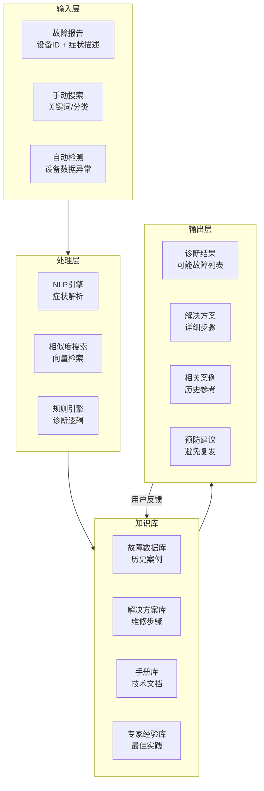

# 📚 天链V3 - 知识库系统

> 充电桩智能运维知识库，包含故障诊断、维修手册、专家经验和智能推荐。

## 🎯 系统目标

### 核心价值
- **快速故障诊断**: 减少故障排查时间
- **标准化维修流程**: 确保维修质量一致性  
- **知识积累与传承**: 避免经验流失
- **智能推荐**: 基于相似故障推荐解决方案

### 关键指标
| 指标 | 目标值 | 当前值 |
|------|--------|--------|
| 平均故障诊断时间 | < 5分钟 | - |
| 维修方案准确率 | > 95% | - |
| 知识库覆盖率 | > 90% | - |
| 用户满意度 | > 4.5/5 | - |

## 🏗️ 系统架构



## 📋 知识库内容结构

### 1. 故障分类体系

#### 一级分类 (按设备模块)
```dataview
TABLE 故障数量, 平均解决时间, 常见症状
FROM "故障分类"
WHERE 一级分类 = "电气系统"
SORT 故障数量 DESC
```

**主要分类**:
- **电气系统** (电压/电流异常、漏电保护、充电故障)
- **通信系统** (网络连接、数据传输、协议错误)
- **机械系统** (锁止机构、充电枪、显示屏)
- **热管理系统** (温度异常、散热故障)
- **软件系统** (固件错误、配置问题、数据异常)

#### 二级分类 (按故障类型)
```yaml
电气系统:
  - 充电故障:
    - 无法启动充电
    - 充电中断
    - 充电速度异常
  - 电压异常:
    - 过压保护
    - 欠压保护  
    - 电压波动
  - 电流异常:
    - 过流保护
    - 电流不平衡
    - 漏电流
```

### 2. 故障解决方案模板

```markdown
## 🔧 故障: {故障名称}

### 📊 基本信息
- **故障代码**: `{代码}`
- **严重等级**: ⚠️ {等级}
- **平均解决时间**: {时间}
- **所需工具**: {工具列表}
- **安全注意事项**: {注意事项}

### 🎯 症状描述
> {典型症状描述}

**常见表现**:
- [ ] 症状1
- [ ] 症状2  
- [ ] 症状3

### 🔍 诊断步骤
1. **初步检查**
   - 检查设备电源状态
   - 查看故障指示灯
   - 检查网络连接状态

2. **详细诊断**
   - 使用万用表测量电压
   - 检查通信模块状态
   - 查看设备日志

3. **确认测试**
   - 执行功能测试
   - 验证修复效果
   - 记录测试结果

### 🛠️ 维修方案
#### 方案A: {主要方案}
**适用条件**: {条件}
**步骤**:
1. {步骤1}
2. {步骤2}
3. {步骤3}

**所需材料**:
- {材料1}
- {材料2}

#### 方案B: {备用方案}
**适用条件**: {条件}
...

### 📝 维修记录模板
```yaml
维修记录:
  设备ID: {设备ID}
  故障代码: {代码}
  维修工程师: {姓名}
  开始时间: {时间}
  结束时间: {时间}
  使用方案: {方案}
  更换部件: {部件列表}
  测试结果: {结果}
  备注: {备注}
```

### 🎓 经验总结
- **关键点**: {关键经验}
- **易错点**: {常见错误}
- **优化建议**: {改进建议}
```

### 3. 专家经验库

#### 经验条目格式
```markdown
---
经验ID: EXP-001
相关故障: [Fault-001, Fault-002]
专家: 张工
等级: 高级
验证次数: 15
成功率: 93%
---

## 💡 经验: {经验标题}

### 问题场景
{详细描述问题场景}

### 传统方案局限性
- {局限性1}
- {局限性2}

### 创新解决方案
{详细解决方案}

### 实施要点
1. {要点1}
2. {要点2}

### 验证结果
- **解决率**: {百分比}
- **时间节省**: {时间}
- **成本降低**: {百分比}

### 适用范围
- {适用条件1}
- {适用条件2}
```

### 4. 维修手册库

#### 手册结构
```markdown
# 📖 {设备型号} 维修手册

## 设备概述
- **型号**: {型号}
- **生产商**: {厂商}
- **技术参数**: {参数}

## 安全规范
> ⚠️ **重要安全警告**

### 电气安全
1. {安全规范1}
2. {安全规范2}

### 操作安全
1. {操作规范1}
2. {操作规范2}

## 维护保养
### 日常维护
- {维护项1}
- {维护项2}

### 定期保养
| 项目 | 周期 | 内容 | 标准 |
|------|------|------|------|
| {项目} | {周期} | {内容} | {标准} |

## 故障排除
### 常见故障
{故障列表}

### 诊断流程
{流程图}

## 备件管理
### 备件清单
{清单表格}

### 更换指南
{更换步骤}
```

## 🔧 智能诊断引擎

### 1. 症状解析 (NLP)
```python
class SymptomParser:
    """症状解析引擎"""
    
    def parse(self, text: str) -> Symptom:
        """
        解析用户输入的症状描述
        返回结构化的症状对象
        """
        # 1. 实体识别 (设备部件、故障现象)
        # 2. 关系提取 (因果关系、时间关系)
        # 3. 严重程度评估
        # 4. 症状分类
        pass
```

### 2. 相似度搜索 (向量检索)
```python
class SimilaritySearch:
    """基于向量检索的相似故障搜索"""
    
    def search(self, symptom: Symptom, top_k: int = 5) -> List[Case]:
        """
        搜索相似故障案例
        """
        # 1. 症状向量化
        # 2. 向量数据库检索
        # 3. 相关性排序
        # 4. 结果返回
        pass
```

### 3. 规则推理引擎
```python
class RuleEngine:
    """基于规则的诊断推理"""
    
    def diagnose(self, symptom: Symptom) -> Diagnosis:
        """
        基于规则进行故障诊断
        """
        # IF-THEN 规则匹配
        # 置信度计算
        # 多规则融合
        pass
```

## 📊 数据统计与分析

### 故障统计看板
```dataviewjs
// 故障统计图表
const data = await dv.query(`
    SELECT 
        故障分类,
        COUNT(*) as 数量,
        AVG(解决时间) as 平均时间,
        AVG(满意度) as 满意度
    FROM "故障记录"
    WHERE date >= date(today) - dur(30 days)
    GROUP BY 故障分类
    ORDER BY 数量 DESC
`);

// 生成图表
dv.paragraph("### 📈 故障统计 (最近30天)");
dv.table(["分类", "数量", "平均时间", "满意度"], data.values);
```

### 知识库质量指标
| 指标 | 计算公式 | 目标值 |
|------|----------|--------|
| **知识覆盖率** | 有解决方案的故障数 / 总故障数 | > 90% |
| **解决方案准确率** | 有效解决方案数 / 总方案数 | > 95% |
| **平均诊断时间** | 总诊断时间 / 诊断次数 | < 5分钟 |
| **用户满意度** | 满意评价数 / 总评价数 | > 4.5/5 |

## 🚀 实施计划

### 第一阶段: 基础知识库建设 (1-2周)
1. **内容收集**
   - [ ] 收集现有维修手册
   - [ ] 整理历史故障记录
   - [ ] 访谈资深工程师

2. **结构化整理**
   - [ ] 建立故障分类体系
   - [ ] 创建解决方案模板
   - [ ] 录入基础知识

3. **系统搭建**
   - [ ] 搭建知识库平台
   - [ ] 实现基础搜索功能
   - [ ] 设计用户界面

### 第二阶段: 智能功能开发 (2-3周)
1. **NLP引擎**
   - [ ] 症状解析模型
   - [ ] 意图识别
   - [ ] 实体抽取

2. **推荐系统**
   - [ ] 相似度计算
   - [ ] 个性化推荐
   - [ ] 反馈学习

3. **移动端集成**
   - [ ] 移动端知识库
   - [ ] 离线访问
   - [ ] 扫码识别

### 第三阶段: 优化与扩展 (持续)
1. **质量优化**
   - [ ] 用户反馈收集
   - [ ] 知识质量评估
   - [ ] 持续改进

2. **功能扩展**
   - [ ] 视频教程库
   - [ ] AR维修指导
   - [ ] 智能问答机器人

## 🔗 相关资源

### 内部链接
- [[故障分类体系]]
- [[维修手册模板]]
- [[专家经验收集指南]]
- [[知识库使用培训]]

### 外部参考
- [充电桩国家标准](链接)
- [设备厂商技术文档](链接)
- [行业最佳实践](链接)

### 工具支持
- **编辑工具**: Obsidian + Dataview
- **搜索引擎**: Elasticsearch
- **向量数据库**: Qdrant
- **NLP服务**: 云服务商NLP

## 📝 更新日志

| 日期 | 版本 | 更新内容 | 负责人 |
|------|------|----------|--------|
| 2026-04-06 | v0.1 | 知识库系统设计文档 | 大圣 |
| 2026-04-10 | v0.2 | 基础知识录入 | 待定 |
| 2026-04-17 | v0.3 | 智能搜索功能 | 待定 |

---

> 💡 **提示**: 本知识库采用 Obsidian 格式，支持双向链接、数据查询和可视化。建议使用 Obsidian 客户端进行编辑和查看。

[[返回首页]] | [[故障报告]] | [[维修记录]]